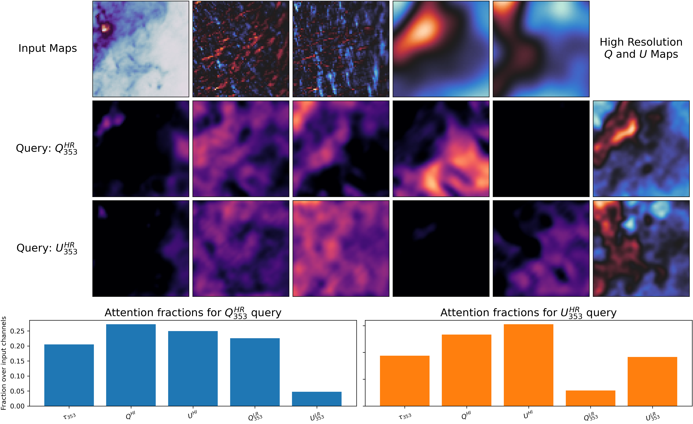

# ML Foregrounds

🚧 *In construction* 🚧

Transformer-based super-resolution of **polarized Galactic dust foregrounds** for cosmic
microwave background (CMB) science. This repository contains the `superres_dust`
package, which trains a hybrid CNN + Transformer model to map coarse Planck GNILC
353 GHz dust polarization maps to high-resolution Stokes *Q* and *U*, fusing in
high-resolution tracers of polarized dust emission (dust total intensity and
neutral hydrogen (HI) based polarization templates).



## Motivation

Polarized thermal dust emission is one of the dominant polarized foreground for CMB searches of primordial $B$-mode polarization. Existing surveys such as Planck map polarized dust emission at degree-scale resolution in diffuse regions, much coarser than the few-arcminute beams targeted by upcoming CMB experiments. Extrapolating to small scales with power laws and Gaussian realizations does not reproduce the filamentary, phase-coherent structure expected in realistic ISM structures.

This project takes a **data-driven fusion** approach to foreground super-resolution: it learns the small-scale polarization field directly on matched patches from multiple high-resolution tracers, and trains a network to *deconvolve* an artificially smoothed variable resolution input map back toward its native resolution.

## Approach

The model performs **4× super-resolution** on flat-sky patches. For each patch it takes
five input channels plus a scalar target resolution, and predicts the high-resolution
Stokes maps:

| Symbol                           | Channel                                                    | Native resolution | Role                  |
| -------------------------------- | ---------------------------------------------------------- | ----------------- | --------------------- |
| $\tau_{353}$                     | Planck R1.20 dust optical depth                            | 5′                | HR tracer (scalar)    |
| $Q^{HI}$, $U^{HI}$               | HI4PI H I based Stokes templates (Hessian filament finder) | 16.2′             | HR tracer (spin-2)    |
| $Q^{LR}*{353}$, $U^{LR}*{353}$   | Coarse GNILC 353 GHz Stokes                                | coarse            | Field to be up-scaled |
| target resolution                | scalar (arcmin)                                            | —                 | Resolution embedding  |
| → $Q^{HR}*{353}$, $U^{HR}*{353}$ | High-resolution GNILC Stokes                               | 15′–30′           | **Prediction target** |

A single network predicts both *Q* and *U*, exploiting the shared information between
the two channels, and generalizes across resolutions via an explicit resolution
embedding.

### Architecture

A hybrid CNN + Transformer, defined in `[skeleton.py](superres_dust/models/modules/skeleton.py)`:

1. **Five residual convolutional encoders** — one per input channel — lift each map to
    `num_channels = 32` feature channels at the input pixelization (no up/down-sampling).
    The target resolution is encoded to the same width via an embedding layer.
    (`[feature_extractor.py](superres_dust/models/modules/feature_extractor.py)`)
2. **Transformer fusion module** — a ViT-style encoder applying global self-attention
    over tokens spanning every input channel *and* spatial location, together with the
    resolution token, fusing heterogeneous inputs without a fixed linear mixing rule.
    (`[transformer_fusion.py](superres_dust/models/modules/transformer_fusion.py)`)
3. **Two convolutional decoders** — the fused $Q^{LR}$ / $U^{LR}$ tokens are decoded
    into the final $Q^{HR}$ / $U^{HR}$ predictions.

The attention weights are exposed for interpretability, enabling per-channel and
per-pixel analysis of which tracers inform the prediction.

Training uses a pixel-wise **$L_1$ (MAE)** loss on normalized fields. The loss is
configurable as a weighted sum of MAE, SSIM, MS-SSIM, and a VGG perceptual loss (see
`[configs/loss_functions.yaml](configs/loss_functions.yaml)`).

## Repository structure

```
ml_foregrounds/
├── superres_dust/               # Main Python package
│   ├── datasets/                # Dataset & LightningDataModule (patch loading, splits)
│   ├── transforms/              # Normalization + D4 augmentation
│   ├── models/
│   │   ├── model.py             # LightningModule (train/val/test loops, optimizer)
│   │   └── modules/             # Skeleton, encoders/decoders, transformer fusion
│   ├── metrics/                 # Image-quality metrics & metric collections
│   └── utils/                   # Loss builder, YAML I/O, WandB map-logging callback
├── configs/
│   ├── model/                   # main.yaml, attention.yaml (architecture hyperparams)
│   ├── runs/                    # main_run.yaml, attention_run.yaml (trainer/data/wandb)
│   └── loss_functions.yaml      # Loss term weights
├── tutorials/
│   ├── test_superres_model.ipynb        # Load a checkpoint and run inference
│   ├── animation_fwhm_slider.py         # Interactive resolution-slider demo
│   └── figures/
├── environment.yml
└── README.md
```

## Installation

The environment is managed with conda:

```bash
conda env create -f environment.yml
conda activate pytorch-nightly
```

Key dependencies: PyTorch, PyTorch Lightning, `torchmetrics`, `timm`, `piq`, `wandb`,
NumPy / SciPy, and Matplotlib.

## Data

The model is trained on flat-sky patches extracted from full-sky HEALPix maps:

- **Target:** the highest-resolution Planck R3.00 GNILC 353 GHz dust polarization maps,
  artificially smoothed by 4× so the network learns to recover the original.
- **Tracers:** Planck $\tau_{353}$ (5′), and HI4PI H I based Stokes templates
  integrated over 13–16 km/s (16.2′), converted to the COSMO / Planck convention.
- **Patches:** `80 × 80` pixels, physical size $20\theta_\mathrm{target} \times
  20\theta_\mathrm{target}$, generated at target resolutions of 15′, 20′, 25′, 30′
  (each 4× up-scaled from 60′ / 80′ / 100′ / 120′).
- **Augmentation:** the dihedral group $D_4$ (4 rotations × mirror flip = 8×), yielding
  ~29,464 patches, split 80% / 10% / 10% into train / validation / test.

Each sample is a `(7, 1, 80, 80)` tensor whose channels are, in order:
`tau, q_hi, u_hi, q_lr, u_lr, q_hr, u_hr`. Normalization maps $\tau_{353}$ to $[0, 1]$
and the Stokes maps to $[-1, 1]$ using fixed bounds
(`[transforms/normalize.py](superres_dust/transforms/normalize.py)`).

The `SRDDataModule` (`[datasets/datamodule.py](superres_dust/datasets/datamodule.py)`)
loads pickled per-patch samples from a data directory, normalizes and augments them,
and caches the resulting `train/val/test_subset.pt` splits. Point it at your data via
the `dir` field in the run config. *(The map data products themselves are not
distributed with this repository.)*

## Usage

### Inference

The tutorial notebook
`[tutorials/test_superres_model.ipynb](tutorials/test_superres_model.ipynb)` shows the
end-to-end flow: build the `SRDDataModule`, load a trained checkpoint into the `Model`
LightningModule, and run super-resolution on validation patches. In brief:

```python
from superres_dust.datasets import SRDDataModule
from superres_dust.models import Model
from superres_dust.utils.loss_functions import get_loss

datamodule = SRDDataModule(config)
datamodule.prepare_data()

model = Model(model_config, loss_func, metrics, ...)
model.load_state_dict(torch.load(checkpoint_path, map_location="cpu")["state_dict"])
model.eval()

# data: (N, 7, 1, 80, 80), resol: (N,) target resolution in arcmin
pred = model(data, resol)          # -> (N, 2, 1, 80, 80): predicted Q_HR, U_HR
```

`animation_fwhm_slider.py` provides an interactive demo of how the prediction changes
as the target resolution (FWHM) is varied.

### Training

Training is built on **PyTorch Lightning** and logged to **Weights & Biases**. The core
components are provided:

- `[Model](superres_dust/models/model.py)` — the `LightningModule` implementing the
  training / validation / test steps, AdamW optimizer, and metric logging.
- `[SRDDataModule](superres_dust/datasets/datamodule.py)` — data preparation and loaders.
- `[MapLogger](superres_dust/utils/map_logger.py)` — a callback that logs example
  input / target / prediction maps to WandB at a configurable cadence.
- Config files under `[configs/](configs/)` specifying architecture, optimizer, trainer,
  and W&B settings (e.g. `configs/model/main.yaml`, `configs/runs/main_run.yaml`).

Assemble these into a PyTorch Lightning `Trainer` to run training, selecting the `main`
(2 transformer layers, 2 heads) or `attention` (1 layer, 1 head) configuration.

### Fiducial hyperparameters

| Quantity                                 | Value                      |
| ---------------------------------------- | -------------------------- |
| Encoder / decoder channel width          | 32                         |
| Residual blocks per encoder / decoder    | 4 / 5                      |
| Transformer layers / attention heads     | 2 / 2                      |
| Dropout                                  | 0                          |
| Learning rate (AdamW, weight decay 0.01) | $10^{-4}$                  |
| Adam $(\beta_1, \beta_2)$                | $(0.9,\ 0.999)$            |
| Train / val / test split                 | 0.8 / 0.1 / 0.1            |
| Augmentations                            | 8 ($D_4$)                  |
| Fiducial loss                            | MAE on normalized $Q$, $U$ |

## Citation

If you use this code, please cite the accompanying paper (in prep).
